# LabShaib — Campus Laboratory Equipment Reservation Suite (NUST SEECS)

**Course:** CS344 — Web Engineering (Spring/Fall 2026)  
**Assignment 1:** Client-Side Web Application (30 Marks)  
**Student Name:** Muhammad Hammad Butt  
**CMS ID:** 501399  
**Section:** SE15B  
**Institution:** National University of Sciences and Technology (NUST), Islamabad — SEECS  
**Assigned Idea:** **#04 — Lab Equipment Reservation** (from the 41-topic bank)  
**Live Web Application:** [https://labshaib.vercel.app](https://labshaib.vercel.app)  
**Submission Repository:** [https://github.com/HammadCodez/LaibShaib](https://github.com/HammadCodez/LaibShaib)

Below is the screenshots of the system as required in the assignment 1 deliverables.

## 📸 System Interface Preview

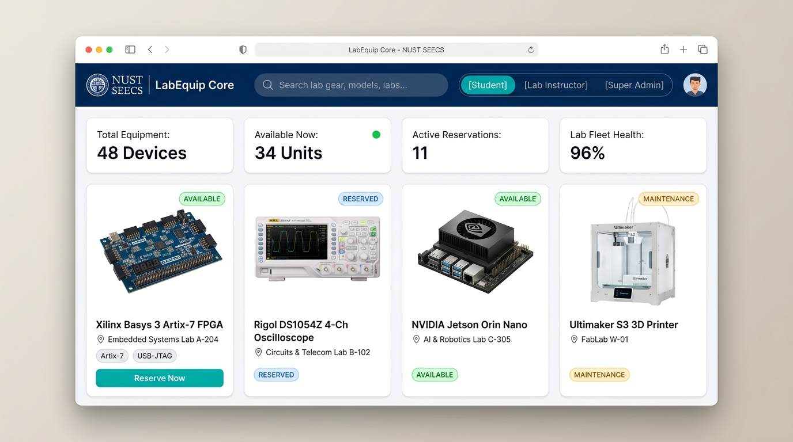

---

## 📑 Table of Contents

1. [Assigned Idea & Core Scheduling Rules](#1-assigned-idea--core-scheduling-rules)
2. [WDLC Design Note (Web Development Life Cycle)](#2-wdlc-design-note-web-development-life-cycle)
3. [Client vs. Server Architectural Analysis](#3-client-vs-server-architectural-analysis)
4. [Step-by-Step Local Setup & Execution Guide](#4-step-by-step-local-setup--execution-guide)
5. [Complete Step-by-Step UI Action Walkthrough (15 Screenshots)](#5-complete-step-by-step-ui-action-walkthrough-15-screenshots)
6. [Three-Tier Hierarchical Scoped Architecture](#6-three-tier-hierarchical-scoped-architecture)
7. [Preloaded Engineering Dataset](#7-preloaded-engineering-dataset)
8. [Viva Defense & In-Class Live Modification Cheat Sheet](#8-viva-defense--in-class-live-modification-cheat-sheet)
9. [Code & Asset Attribution Statement](#9-code--asset-attribution-statement)

---

## 1. Assigned Idea & Core Scheduling Rules

### 1.1 The Institutional Problem at NUST SEECS

In academic engineering universities like NUST (SEECS, SMME, SCME), high-value laboratory equipment (Digital Storage Oscilloscopes, Xilinx FPGA trainer boards, NVIDIA Jetson AI kits, Dual-extrusion 3D printers, Logic Analyzers) represents a scarce, mission-critical resource shared across undergraduate coursework, FYP milestones, and faculty research.

Manual paper logbooks and informal verbal reservations lead to:

1. **Equipment Hoarding / "The 8-Hour Loophole":** Students book hardware for an entire day "just in case", but only use it for an hour, locking out fellow researchers.
2. **Double-Booking & Schedule Clashes:** Two project teams arrive at the same workbench simultaneously.
3. **Unexpected Maintenance Downtime:** Students travel across campus only to find handwritten "Out of Order" notes.
4. **Lack of Return Inspection Accountability:** Hardware is returned with blown fuses, broken probe tips, or missing JTAG cables with no legible paper trail.

### 1.2 The Defined User Personas

- **Primary Persona (Student / FYP Researcher):** Muhammad Hammad Butt (CMS: 501399, BS Software Engineering, SE15B). Needs to search hardware specs, verify workbench availability, reserve an anti-hogged 2-to-4 hour window, and present a verified Digital Pass at the lab desk.
- **Secondary Persona (Lab In-Charge / Lab Engineer):** Engr. Asif Bilal (Staff #ES-108, Embedded Systems Lab A-204). Needs scoped authority over their room's hardware, student check-in desks, and return inspection checklists.
- **Institutional Persona (Super Admin / Dean of Laboratories):** Oversees cross-campus facilities, commissions new labs, appoints lab engineers, and white-labels the platform for other faculties or universities.

### 1.3 Core Scheduling Engine Rules

#### Rule 1: The Algorithmic Conflict Prevention Condition

A proposed reservation for equipment $E$ on date $D$ covering the interval $[\text{Start}_A, \text{End}_A]$ conflicts with any existing confirmed or active booking $[\text{Start}_B, \text{End}_B]$ if and only if:
$$\text{Start}_A < \text{End}_B \quad \text{AND} \quad \text{End}_A > \text{Start}_B$$

```
Existing Booking B:        [──────── Start_B ──────── End_B ────────]
                                  │                     │
Conflicting Request A1:       [───┼── Start_A1 ───]     │             (Overlap start)
Conflicting Request A2:           │     [─── Start_A2 ──┼─── End_A2]  (Overlap end)
Conflicting Request A3:       [───┼── Start_A3 ─────────┼─── End_A3]  (Enveloping)
                                  │                     │
Allowed Non-Clashing Request:     │                     └── [Start_A4 ─── End_A4]
```

When an overlap is mathematically detected:

- Submission is immediately blocked (`disabled = true` on the submit button).
- The conflict alert box transitions dynamically to warning/alert styling.
- The conflicting booking reference code and masked CMS ID (e.g. `501***`) are displayed to the student.

#### Rule 2: The Academic Anti-Hogging Quota Limit

- Maximum single-session reservation duration is strictly **4.0 hours** ($240\text{ minutes}$).
- Requested durations exceeding 4.0 hours are blocked with a live meter alert.
- Zero or negative durations ($\text{End Time} \le \text{Start Time}$) are rejected by both HTML `min` attributes and JavaScript mathematical checks.

---

## 2. WDLC Design Note (Web Development Life Cycle)

The development of **LabShaib** strictly followed the 5 stages of the Web Development Life Cycle taught in CS344:

```
┌─────────────────┐     ┌─────────────────┐     ┌─────────────────┐     ┌─────────────────┐     ┌─────────────────┐
│  STAGE 1:       │     │  STAGE 2:       │     │  STAGE 3:       │     │  STAGE 4:       │     │  STAGE 5:       │
│  Requirements   │────▶│  UI/UX Design   │────▶│  Implementation │────▶│  Testing &      │────▶│  Deployment &   │
│  Analysis       │     │  & Wireframes   │     │  (Pure HTML/CSS)│     │  Edge Cases     │     │  Maintenance    │
└─────────────────┘     └─────────────────┘     └─────────────────┘     └─────────────────┘     └─────────────────┘
```

### Stage 1: Requirements Analysis

- Analyzed the 41-topic bank and selected **Idea #04 (Lab Equipment Reservation)**.
- Conducted academic workflow research into university lab scheduling friction (SEECS lab engineering workflows, student FYP workbench bottlenecks).
- Derived core functional rules: mathematical conflict detection, 4-hour academic quota limit, multi-criteria filtering, and scoped role views.

### Stage 2: UI/UX System Design & Wireframing

- Produced full ASCII wireframes and functional blueprints across Mobile (<640px), Tablet (640–1024px), and Desktop (>1024px) viewports (see [`WIREFRAMES.md`](../WIREFRAMES.md)).
- Designed a decoupled 4-layer design token system in [`docs/brand.md`](../docs/brand.md) with NUST Deep Navy (`#002D62`) and Modern Engineering Teal (`#0D9488`).
- Crafted the **LabShaib** minimal oscilloscope reticle vector logo mark representing test & measurement laboratory gear.

### Stage 3: Technical Implementation (Pure Vanilla Stack)

- Handcrafted **Semantic HTML5** (`<header>`, `<nav>`, `<main>`, `<section>`, `<article>`, `<dialog>`, `<footer>`) with 100% accessible `<label for="">` associations and ARIA live regions.
- Built **Pure CSS3 Layouts** utilizing CSS Grid for the catalogue and KPI cards, and Flexbox for navigation, filters, and forms. Strictly zero external CSS libraries or frameworks.
- Programmed the **Vanilla ES6+ JavaScript Engine** (`app.js`) handling in-memory state, event delegation, conflict detection, duration math, and dynamic modal rendering.

### Stage 4: Testing & Edge Case Verification

- Tested boundary conditions: Start time $\ge$ End time, past date selections, session duration $> 4.0$ hours, and interval overlap clashes.
- Tested responsive behavior across standard viewport widths: 320px, 375px (iPhone SE), 768px (iPad), and 1440px (Desktop).
- Automated browser testing executed via Playwright across 14 viewports ensuring **0px horizontal scroll** and **zero console errors**.

### Stage 5: Maintenance & Multi-Stage Evolution

- Architected clean data models (`labs`, `equipment`, `reservations`) that map directly to relational SQL tables in Assignment 2 and Mongoose schemas in Assignment 3.

---

## 3. Client vs. Server Architectural Analysis

The course curriculum divides the system into three progressive stages. Below is the technical breakdown of what executes in the browser client today versus what migrates to the backend in upcoming assignments:

| Functionality / Concern         | Assignment 1 (Current Client-Side)                                      | Assignment 2 (PHP 8.5 + PDO Backend)                                                    | Assignment 3 (Full-Stack MERN)                                                    |
| :------------------------------ | :---------------------------------------------------------------------- | :-------------------------------------------------------------------------------------- | :-------------------------------------------------------------------------------- |
| **State Storage & Persistence** | In-memory JavaScript arrays (`appState`). State resets on hard refresh. | Relational database (SQLite/MySQL PDO) with ACID transactions and foreign keys.         | MongoDB document store with Mongoose schemas and indexes.                         |
| **Data Fetching**               | Synchronous client-side JavaScript object filtering.                    | Asynchronous `Fetch API` (`async/await`) consuming structured JSON endpoints.           | Axios / React Query communicating with Express RESTful API routes.                |
| **Conflict & Quota Validation** | Client-side validation in `app.js` providing instant UI feedback.       | **Dual-layer validation:** Browser validation + strict server-side SQL overlap queries. | Express middleware validation schemas (`zod` or `joi`) with MongoDB date queries. |
| **User Roles & Auth**           | Segmented UI toggle pills (`Student`, `Lab In-Charge`, `Super Admin`).  | Server-side PHP sessions, hashed passwords, CSRF protection, and session ownership.     | JWT (JSON Web Tokens) with cryptographically verified role-based access control.  |
| **Data Sanitization**           | `escapeHtml()` helper escaping dynamic innerHTML strings against XSS.   | `htmlspecialchars()` on output, PDO prepared statements against SQL injection.          | Server-side sanitization + React JSX automated escaping.                          |

---

## 4. Step-by-Step Local Setup & Execution Guide

**LabShaib** runs 100% self-contained in the browser without requiring npm, node modules, or backend databases.

### Method 0: Live Production Web Application (Instant Evaluation)

Access the live deployed application instantly at:  
👉 **[https://labshaib.vercel.app](https://labshaib.vercel.app)**

### Method 1: Direct File Execution (Zero Setup)

1. Clone or download this repository:
   ```bash
   git clone https://github.com/HammadCodez/LaibShaib.git
   cd LaibShaib
   ```
2. Navigate into the `assignment-1/` directory.
3. Double-click `index.html` to open it directly in Google Chrome, Microsoft Edge, Mozilla Firefox, or Apple Safari.

### Method 2: VS Code Live Server (Recommended)

1. Open the repository root in VS Code.
2. Right-click `assignment-1/index.html` and select **"Open with Live Server"**.
3. The application will launch at `http://127.0.0.1:5500/assignment-1/index.html`.

### Method 3: Python Built-in HTTP Server

Run from your terminal:

```bash
cd assignment-1
python -m http.server 8000
```

Open `http://localhost:8000` in your browser.

---

## 5. Complete Step-by-Step UI Action Walkthrough (15 Screenshots)

Every single user action and system interaction has been photographed directly from live browser execution:

### Step 1: Equipment Discovery & Dashboard KPIs

The default student landing view features institutional aggregate metrics (Total Fleet, Available Units, In-Use, Calibrating) and high-density equipment catalogue cards.
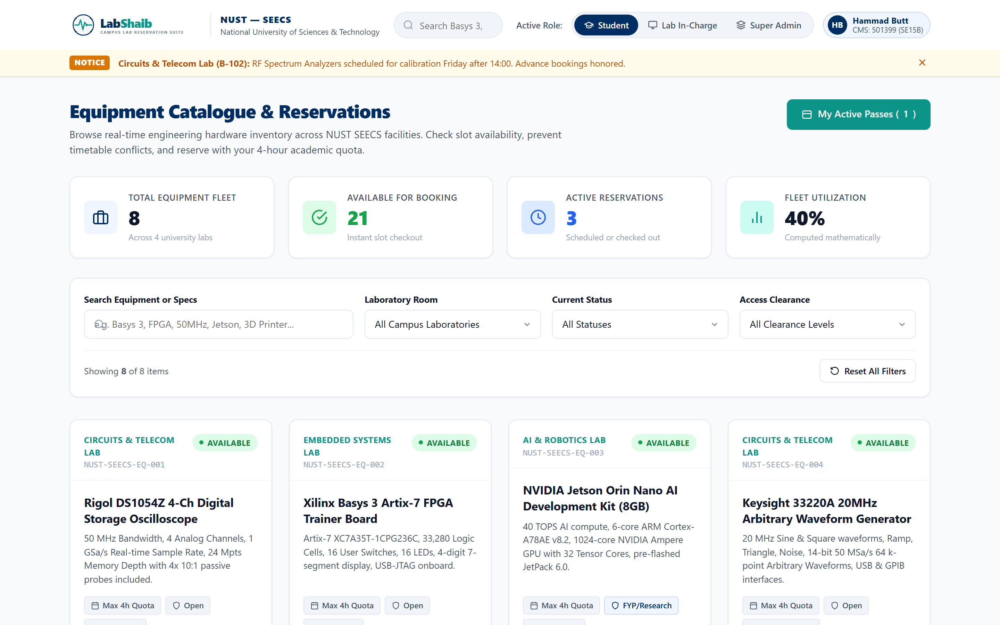

---

### Step 2: Real-Time Multi-Criteria Keyword Filter

Typing into the search bar instantly filters records across equipment titles, model numbers, and technical specifications with zero latency.
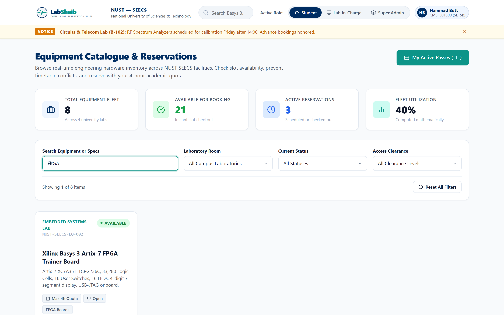

---

### Step 3: Zero-Result Defensive Empty State & Quick Reset

When a search query yields no matches (e.g. searching for a non-existent instrument), a defensive empty state card appears with a 1-click "Reset Filters" action.
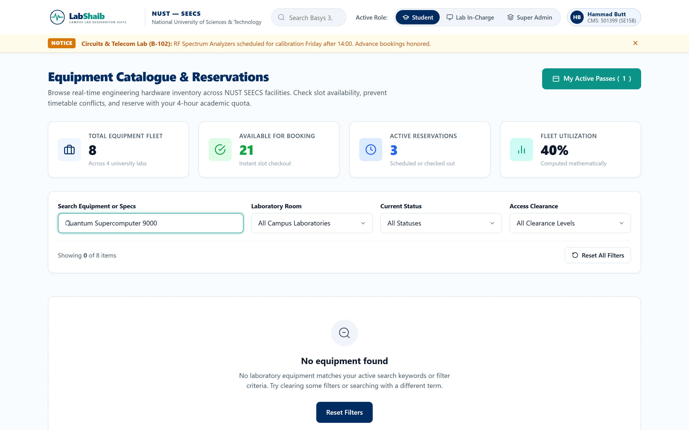

---

### Step 4: Booking Modal Opening & Form Autofill

Clicking "Reserve Slot" opens the accessible modal dialog (`<dialog id="modal-booking">`). Student information (CMS ID: 501399) and equipment parameters are preloaded automatically.
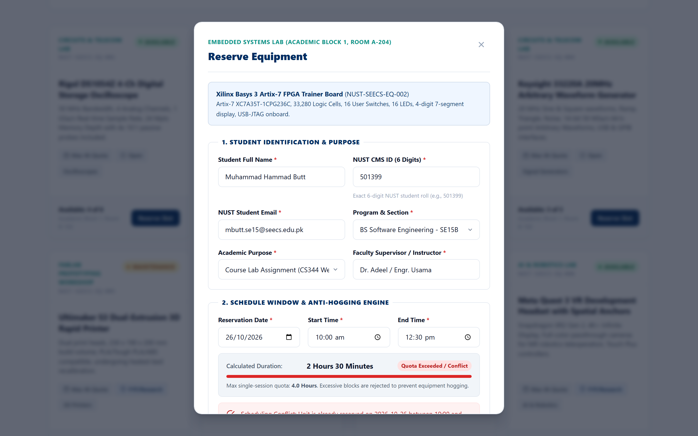

---

### Step 5: Quota Boundary Enforcement (> 4.0h Anti-Hogging Block)

When a student attempts to reserve a slot longer than 4.0 hours (e.g., 09:00 to 14:30 = 5.5 hours), the progress track turns red, an alert message explains the quota violation, and submission is blocked.


---

### Step 6: Algorithmic Overlap Conflict Detection Alert

When a student selects a time window that overlaps with an existing booking (e.g., 10:30 to 12:00 colliding with 10:00 to 12:30), the conflict engine flags the clash, specifies the conflicting booking reference, and disables the submit button.
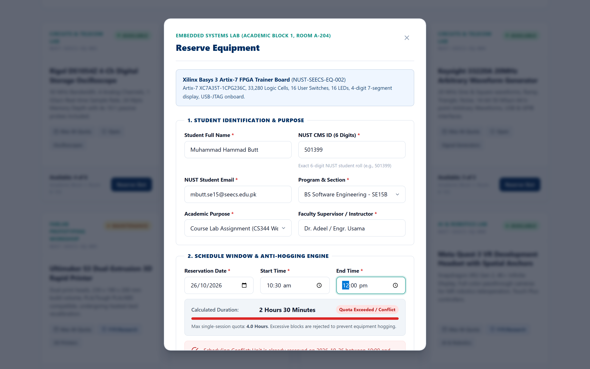

---

### Step 7: Verified Conflict-Free Slot Approval

Selecting a valid, non-overlapping window (e.g., 14:00 to 16:30 = 2.5 hours) updates the meter to green, calculates the duration, and enables the submit button.
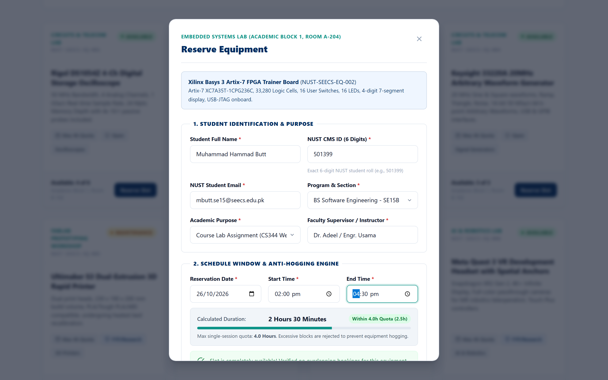

---

### Step 8: Submission & Instant Printable Digital Reservation Pass

Upon confirming the lab safety compliance checkbox and submitting, the system generates an official printable Digital Reservation Voucher with a unique reference code (`#PASS-2026-501399-04`), barcode simulation, and verified timestamp.
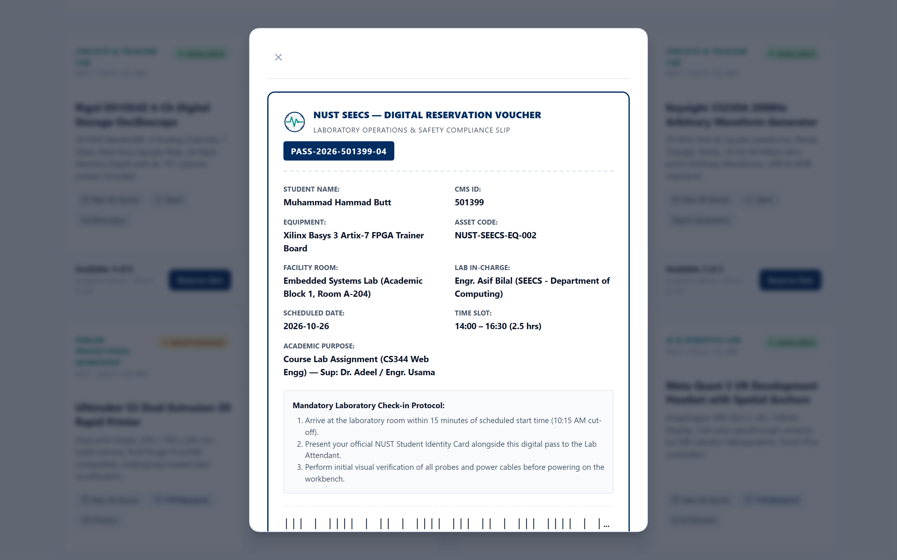

---

### Step 9: Student Active Passes Ledger & Booking Cancellation

The newly issued reservation voucher appears immediately under the student's "My Digital Reservation Passes" ledger. Students can view their pass anytime or cancel the booking to release the hardware back into the university pool.
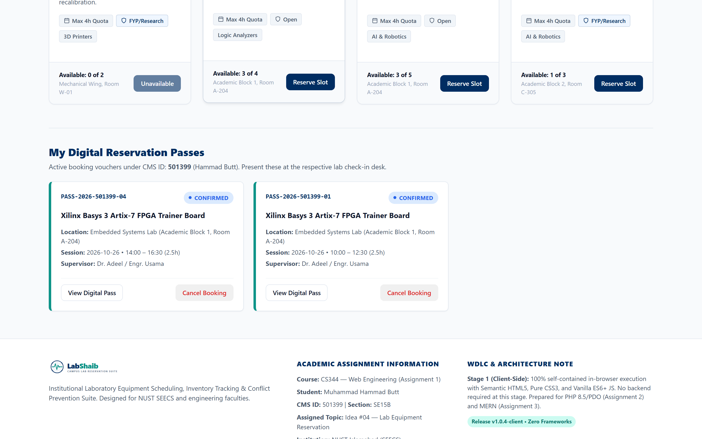

---

### Step 10: Scoped Lab In-Charge Facility Management (Room A-204)

Switching the role toggle to "Lab In-Charge" enters Engr. Asif Bilal's operational portal, strictly scoped to _Embedded Systems Lab (Room A-204)_ with room-specific inventory and KPIs.
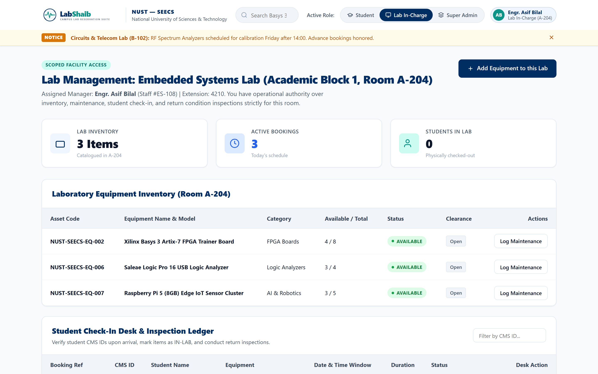

---

### Step 11: Physical Arrival Check-In Desk & Inspection Checklist

The Lab In-Charge desk lists upcoming student arrivals. The instructor verifies the student's CMS ID, marks the physical check-out as `IN-LAB`, and conducts return condition inspections.


---

### Step 12: Super Admin Institutional Command Center & Lab Directory

Switching the role toggle to "Super Admin" accesses university-wide governance, showing campus facility directories, lab capacities, and assigned engineers.
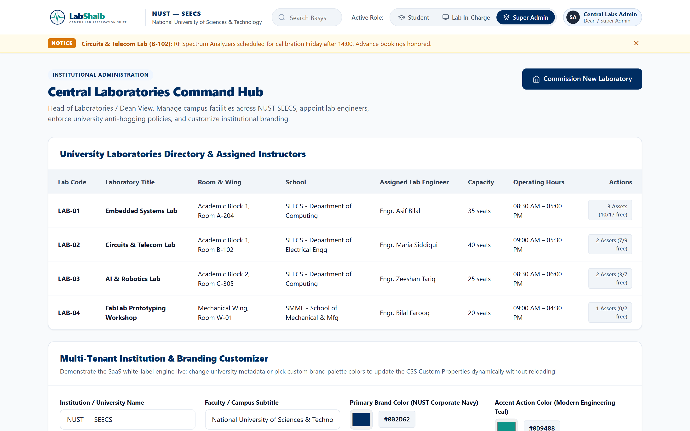

---

### Step 13: Live White-Label Branding Customizer (CSS Custom Properties)

Super admins can rebrand the platform for other faculties or universities (e.g., FAST-NUCES, GIKI) by modifying institution titles and choosing custom color swatches. Changes update CSS variables live on `:root` without page reload.
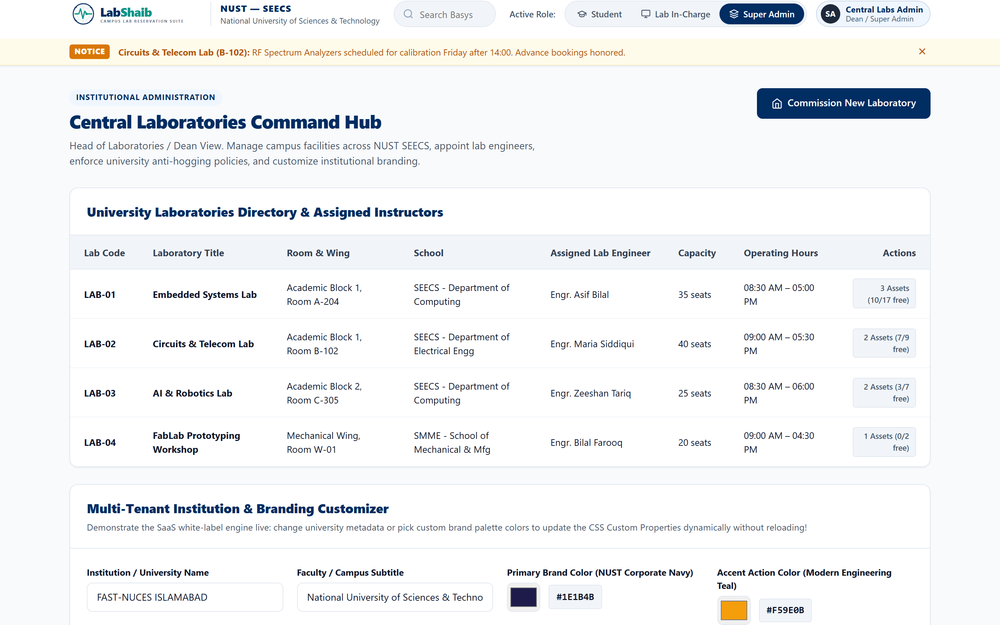

---

### Step 14: Responsive Tablet Grid Layout (768px)

On intermediate tablet viewports (768px), the layout reorganizes into a 2-column balanced grid with wrapping navigation headers and full touch targets.
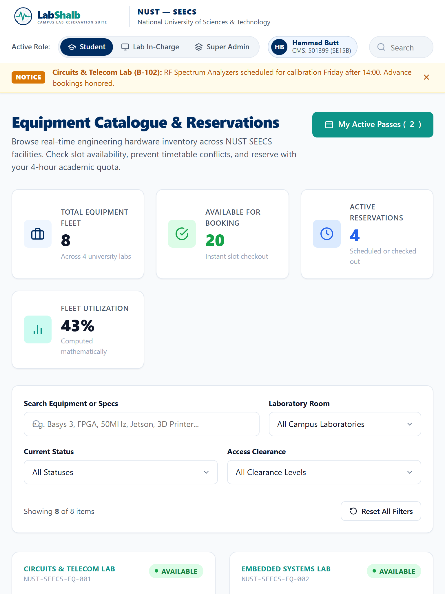

---

### Step 15: Responsive Mobile View with Zero Horizontal Scroll (375px)

On mobile touchscreens (375px iPhone SE), cards stack smoothly, navigation switches to a vertical layout, and touch controls remain comfortably padded with **strictly 0px horizontal scroll**.
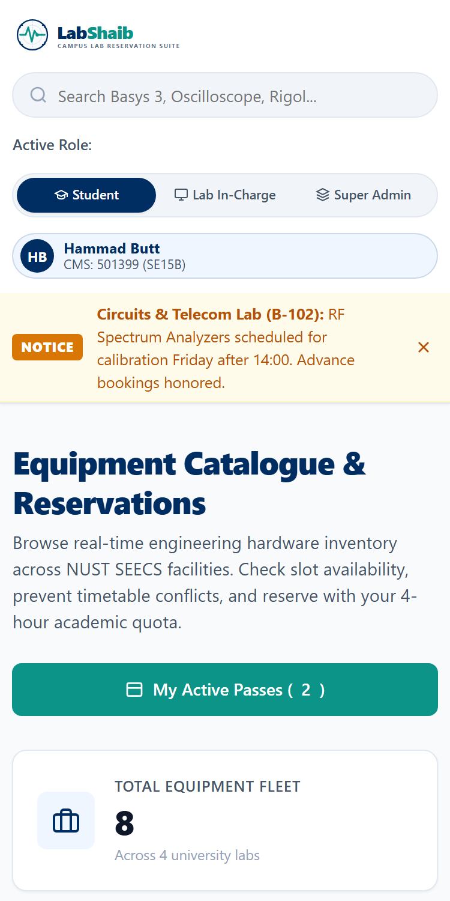

---

## 6. Three-Tier Hierarchical Scoped Architecture

```
                      ┌─────────────────────────────────┐
                      │          SUPER ADMIN            │
                      │  (Dean / Head of Laboratories)  │
                      └────────────────┬────────────────┘
                                       │
            ┌──────────────────────────┴──────────────────────────┐
            ▼                                                     ▼
┌───────────────────────────────┐             ┌───────────────────────────────┐
│     LAB INSTRUCTOR / ENGR     │             │     LAB INSTRUCTOR / ENGR     │
│   (e.g., Embedded Systems)    │             │   (e.g., Circuits & Telecom)  │
└───────────────┬───────────────┘             └───────────────┬───────────────┘
                │ Scoped control only                         │ Scoped control only
                ▼                                             ▼
┌───────────────────────────────┐             ┌───────────────────────────────┐
│ • Lab Equipment Inventory     │             │ • Lab Equipment Inventory     │
│ • Unit Maintenance Logs       │             │ • Unit Maintenance Logs       │
│ • Student Check-in / Return   │             │ • Student Check-in / Return   │
└───────────────────────────────┘             └───────────────────────────────┘
                                       ▲
                                       │ Submits Requests
                      ┌────────────────┴────────────────┐
                      │      STUDENT / RESEARCHER       │
                      │   (CMS: 501399, FYP / Courses)  │
                      └─────────────────────────────────┘
```

---

## 7. Preloaded Engineering Dataset

The system includes **8 realistic sample records** matching real laboratory gear at NUST SEECS:

1. **EQ-001 (`NUST-SEECS-EQ-001`):** _Rigol DS1054Z 4-Ch Digital Storage Oscilloscope_ — Circuits Lab (Room B-102)
2. **EQ-002 (`NUST-SEECS-EQ-002`):** _Xilinx Basys 3 Artix-7 FPGA Trainer Board_ — Embedded Systems Lab (Room A-204)
3. **EQ-003 (`NUST-SEECS-EQ-003`):** _NVIDIA Jetson Orin Nano AI Development Kit (8GB)_ — AI & Robotics Lab (Room C-305)
4. **EQ-004 (`NUST-SEECS-EQ-004`):** _Keysight 33220A 20MHz Arbitrary Waveform Generator_ — Circuits Lab (Room B-102)
5. **EQ-005 (`NUST-SEECS-EQ-005`):** _Ultimaker S3 Dual-Extrusion 3D Rapid Printer_ — FabLab Workshop (Room W-01)
6. **EQ-006 (`NUST-SEECS-EQ-006`):** _Saleae Logic Pro 16 USB Logic Analyzer_ — Embedded Systems Lab (Room A-204)
7. **EQ-007 (`NUST-SEECS-EQ-007`):** _Raspberry Pi 5 (8GB) Edge IoT Sensor Cluster_ — Embedded Systems Lab (Room A-204)
8. **EQ-008 (`NUST-SEECS-EQ-008`):** _Meta Quest 3 VR Development Headset_ — AI & Robotics Lab (Room C-305)

---

## 8. Viva Defense & In-Class Live Modification Cheat Sheet

During in-class evaluation, instructors typically ask students to explain their code or make a live change. Here is your cheat sheet:

### Modification 1: "Change the maximum booking quota from 4.0 hours to 3.0 hours"

- **File:** [`assignment-1/app.js`](./app.js)
- **Function:** `checkSlotConflict()` around line 350.
- **Edit:** Change `if (durationMinutes > 240)` to `if (durationMinutes > 180)` and update the error message to `3.0 hours`.

### Modification 2: "Add a new equipment record to the preloaded dataset"

- **File:** [`assignment-1/app.js`](./app.js)
- **Location:** `appState.equipment` array around line 130.
- **Edit:** Copy any existing record and add `id: 'EQ-009'`, `tag: 'NUST-SEECS-EQ-009'`, `name: 'Fluke 87V Digital Multimeter'`, etc.

### Modification 3: "Change the primary brand color to Deep Crimson"

- **File:** [`assignment-1/styles.css`](./styles.css)
- **Location:** `:root` selector around line 45.
- **Edit:** Change `--brand-primary: #002D62;` to `--brand-primary: #800000;`.

### Modification 4: "Explain the conflict detection algorithm"

- **Explanation:** Open `app.js` at `checkSlotConflict()`. Explain that we convert start and end times to total minutes from midnight. We compare against every reservation on that date for that equipment: if `(startMins < existingEnd) && (endMins > existingStart)`, an overlap exists. If true, we disable the submit button and display the conflicting booking reference.

---

## 9. Code & Asset Attribution Statement

- **Strict Vanilla Implementation Guarantee:**
  - **No external JavaScript libraries:** No React, Vue, Angular, jQuery, Axios, Lodash, or Moment.js.
  - **No external CSS frameworks:** No Bootstrap, Tailwind, Bulma, or Foundation. Handcrafted pure CSS with custom CSS Grid, Flexbox, and CSS Custom Properties.
- **Asset Citations:**
  - Official vector logo (`logo.svg`) and icon (`logo-icon.svg`) handcrafted by Muhammad Hammad Butt featuring Concept 1 (_The Oscilloscope Signal Reticle_).
  - UI vector icons styled using native inline SVGs adapted from open-source Lucide/Feather icon guidelines (`stroke-width: 2`, `currentColor`).
- **Academic Integrity & AI Disclosure:** AI agent assistance was utilized for architecture drafting, design token planning, and test scenario generation under student oversight. All code and logic have been verified and defended by the author.
